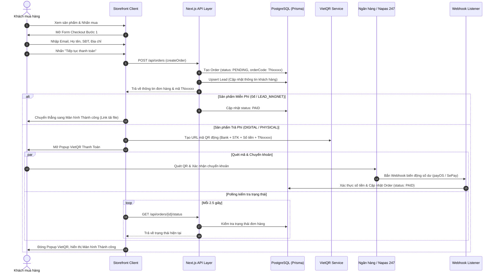

# Quy Trình Tạo Đơn Hàng & Thanh Toán VietQR Tự Động (Order Creation & VietQR Payment Flow)

Tài liệu này mô tả chi tiết toàn bộ kiến trúc, luồng dữ liệu (Data Flow), vòng đời trạng thái (State Lifecycle) và cơ chế trả hàng tự động cho hệ thống tạo đơn trên nền tảng **Tiệm Nhỏ**.

---

## 1. Tổng Quan Kiến Trúc (Architecture Overview)

Hệ thống checkout của Tiệm Nhỏ được thiết kế theo triết lý **Clean Minimalist & Tối ưu chuyển đổi Mobile WebView** (TikTok, Instagram, Facebook Bio Link):
- **Không điều hướng rời trang (No Redirect):** Khách hàng hoàn tất nhập thông tin và quét mã VietQR ngay trên cùng một màn hình hoặc Drawer/Modal.
- **Mô hình Direct-to-Bank (0% Escrow):** Tiền từ tài khoản ngân hàng của người mua chuyển thẳng vào số tài khoản ngân hàng của Creator thông qua Napas 247.
- **Tự động kích hoạt (Instant Fulfillment):** Webhook xác thực giao dịch trong 2 - 3 giây, mở khóa link tải tài nguyên hoặc ghi nhận đơn hàng vật lý ngay tức thì.

---

## 2. Sơ Đồ Trình Tự Luồng Tạo Đơn (Sequence Diagram)



---

## 3. Chi Tiết 4 Giai Đoạn Vòng Đời Đơn Hàng

### Giai Đoạn 1: Tiếp Nhận Thông Tin (Checkout Step 1)

- **Component:** `CheckoutDrawerStep1.tsx`
- **Các trường dữ liệu thu thập:**
  1. `customerEmail` (Bắt buộc, `inputMode="email"`): Dùng để gửi file, link truy cập và liên hệ chăm sóc.
  2. `customerName` (Bắt buộc): Họ và tên khách hàng.
  3. `customerPhone` (Bắt buộc đối với đơn PHYSICAL; tùy chọn đối với DIGITAL).
  4. `shippingAddress` (Chỉ hiển thị khi loại sản phẩm là `PHYSICAL` - Hàng thủ công / đặt trước).
  5. `customerNote` (Ghi chú giao hàng bổ sung).
- **Nguyên tắc UX:**
  - Thuộc tính `noValidate` được bật trên `<form>` để chặn tooltip trình duyệt mặc định, thay bằng thông báo lỗi màu đỏ nội tuyến (`text-rose-500 text-xs`).
  - Nút Primary CTA luôn hiển thị rõ ràng số tiền và trạng thái loading (spinner), ngăn ngừa submit 2 lần (double submission).

---

### Giai Đoạn 2: Khởi Tạo Đơn Hàng PENDING & Tạo Link Thanh Toán payOS

- **Hàm xử lý:** `createOrder(data: CreateOrderInput)` tại `src/features/tiemnho/api/services/order.service.ts`.
- **Logic thực thi:**
  1. Kiểm tra sự tồn tại của sản phẩm trong cơ sở dữ liệu (`prisma.product.findUnique`).
  2. Sinh mã đơn hàng dạng số `orderCodeNumber` (6 chữ số) và mã hiển thị `TN` + số (ví dụ: `TN384721`).
  3. Xác định loại giao dịch:
     - Nếu giá tiền = `0đ` hoặc loại sản phẩm là `LEAD_MAGNET`: Thiết lập trạng thái `status = 'PAID'`, `paidAt = now()`. Tự động gửi email giao hàng qua Resend.
     - Nếu giá tiền `> 0đ`: Thiết lập `status = 'PENDING'`, phương thức thanh toán `VIETQR`.
  4. **Tạo Link Thanh Toán Tự Động qua payOS (`createPayOSPaymentLink`):**
     - Đọc cấu hình thanh toán đa người dùng (`PaymentConfig`) của Creator (hoặc biến môi trường hệ sinh thái `PAYOS_CLIENT_ID`, `PAYOS_API_KEY`, `PAYOS_CHECKSUM_KEY`).
     - Gọi `payos.paymentRequests.create`:
       - `orderCode`: số nguyên dương duy nhất (`orderCodeNumber`).
       - `amount`: số tiền đơn hàng.
       - `description`: mã đơn rút gọn (`TN384721`, tối đa 25 ký tự theo quy định Napas).
       - `returnUrl` / `cancelUrl`: điều hướng về trang kết quả đơn hàng.
     - Nhận về `checkoutUrl`, chuỗi `qrCode` EMVCo, và `paymentLinkId`.
     - Lưu trực tiếp `checkoutUrl`, `qrCode`, `paymentLinkId` vào cơ sở dữ liệu `Order`.
     - Cơ chế dự phòng (Graceful Fallback): Nếu Creator chưa điền API keys payOS hoặc gọi API thất bại, hệ thống tự động fallback về chuẩn VietQR QuickLink, đảm bảo khách hàng luôn quét mã và thanh toán được 100%.
  5. Ghi nhận hoặc cập nhật hồ sơ khách hàng tiềm năng (`Lead` table) qua email: tăng tổng chi tiêu (`totalSpent`) và số đơn hàng (`ordersCount`).
  6. Đơn hàng được trả về Client. Client nhận `checkoutUrl` và mã QR để mở giao diện thanh toán.

---

### Giai Đoạn 3: Thanh Toán Qua VietQR & Xác Thực Tự Động

- **Component:** `VietQrPaymentPopup.tsx`
- **Cơ chế hiển thị mã QR:**
  - Sử dụng chuẩn ảnh VietQR Quick Link:
    ```
    https://img.vietqr.io/image/{bankId}-{accountNumber}-compact.png?amount={amount}&addInfo={orderCode}&accountName={accountName}
    ```
  - Khung mã QR bo góc `rounded-2xl`, tối ưu vừa vặn trong màn hình di động mà không cần cuộn trang.
  - Tích hợp tính năng **"Lưu mã QR vào máy"**: Tải trực tiếp file PNG về máy điện thoại để người mua có thể mở app ngân hàng và quét ảnh từ thư viện.
- **Thẻ thông tin chuyển khoản hợp nhất:**
  - Tên ngân hàng & Tên chủ tài khoản.
  - Số tài khoản (kèm nút sao chép nhanh).
  - Số tiền chính xác theo đơn (kèm nút sao chép).
  - Nội dung chuyển khoản: Bắt buộc là mã đơn hàng `TNxxxxx` (nổi bật trên nền vàng nhạt, kèm nút sao chép).
- **Cơ chế xác thực kép (Dual Verification):**
  1. **Webhook Server-to-Server (Chính):** Webhook từ payOS gửi trực tiếp vào endpoint `/api/webhooks/payos` (hoặc `/api/webhooks/vietqr` đối với SePay). Khớp mã đơn `TNxxxxx` và số tiền `transferAmount >= order.amount`. Cập nhật `status = 'PAID'`. Tự động kích hoạt email giao hàng qua Resend.
  2. **Client Polling Fallback (Phụ):** Client tự động kiểm tra mỗi 2.5 giây qua route `/api/orders/[id]/status`. Khi đơn hàng chuyển sang `PAID`, popup tự động đóng và chuyển sang màn hình thành công.
  3. **Kiểm tra thủ công (Manual Check):** Nút *"Tôi đã chuyển khoản xong"* cho phép khách yêu cầu hệ thống rà soát giao dịch tức thì.

---

### Giai Đoạn 4: Trả Hàng Tự Động (Fulfillment Step 3) & Bàn Giao

- **Sản phẩm số (DIGITAL):**
  - Hệ thống cấp phát liên kết tải về an toàn thông qua cơ chế `DownloadGrant`:
    - Token dùng một lần hoặc có giới hạn thời gian (mặc định 72 giờ).
    - Giới hạn số lần tải (ví dụ: tối đa 5 lần) nhằm chống phát tán lậu tài nguyên số.
  - Khách hàng có thể nhấn nút tải trực tiếp trên giao diện hoặc mở email xác nhận đơn hàng.
- **Quà tặng 0đ (LEAD_MAGNET):**
  - Hiển thị ngay nút nhận tài liệu / mở link nhóm Zalo / link Google Drive mà không qua bước thanh toán.
  - Hồ sơ khách hàng được phân loại `sourceType = 'LEAD_MAGNET'`.
- **Sản phẩm vật lý (PHYSICAL):**
  - Đơn hàng chuyển sang trạng thái vận chuyển `shippingStatus = 'UNFULFILLED'`.
  - Creator xem địa chỉ nhận hàng trên bảng điều khiển Quản lý Đơn hàng (`/dashboard/orders`), tiến hành đóng gói và cập nhật sang `SHIPPING` hoặc `COMPLETED`.
  - Hỗ trợ xuất dữ liệu ra file Excel/CSV gửi bưu cục bưu điện (Viettel Post, GHTK, EMS).

---

## 4. Bảng Trạng Thái Đơn Hàng (State Machine)

| Trạng thái (`status`) | Ý nghĩa | Hành động tiếp theo |
| :--- | :--- | :--- |
| `PENDING` | Đơn hàng vừa tạo, đang chờ chuyển khoản VietQR | Client mở Popup QR; hệ thống chờ Webhook xác nhận |
| `PAID` | Đã nhận đủ tiền vào tài khoản ngân hàng của Creator | Mở khóa link tải file, gửi email xác nhận, tăng soldCount |
| `CANCELLED` | Đơn hàng bị hủy do hết hạn đếm ngược (15 phút) hoặc Creator hủy | Ngừng kiểm tra trạng thái |

### Trạng thái Giao Hàng Cho Sản Phẩm Vật Lý (`shippingStatus`)

| Trạng thái | Ý nghĩa |
| :--- | :--- |
| `UNFULFILLED` | Đã thanh toán, đang chờ Creator chuẩn bị hàng |
| `SHIPPING` | Đã giao cho đơn vị vận chuyển (kèm mã vận đơn nếu có) |
| `COMPLETED` | Khách đã nhận được hàng thành công |

---

## 5. Cấu Trúc Bảng Dữ Liệu Liên Quan (Prisma Schema)

```prisma
model Order {
  id              String          @id @default(cuid())
  orderCode       String          @unique // Định dạng: TN + 5 chữ số
  creatorId       String
  productId       String
  productTitle    String
  productType     String          // DIGITAL | LEAD_MAGNET | PHYSICAL | EXTERNAL_LINK
  amount          Float
  customerName    String
  customerEmail   String
  customerPhone   String?
  shippingAddress String?
  customerNote    String?
  status          String          @default("PENDING") // PENDING | PAID | CANCELLED
  shippingStatus  String?         // UNFULFILLED | SHIPPING | COMPLETED
  paymentMethod   String          @default("VIETQR")
  downloadUrl     String?
  paidAt          DateTime?
  createdAt       DateTime        @default(now())
  updatedAt       DateTime        @updatedAt

  product         Product         @relation(fields: [productId], references: [id])
  creator         CreatorProfile  @relation(fields: [creatorId], references: [id])
}

model Lead {
  id            String          @id @default(cuid())
  creatorId     String
  name          String
  email         String
  phone         String?
  sourceProduct String
  sourceType    String          @default("PURCHASE") // PURCHASE | LEAD_MAGNET
  totalSpent    Float           @default(0)
  ordersCount   Int             @default(1)
  createdAt     DateTime        @default(now())
  updatedAt     DateTime        @updatedAt

  @@unique([creatorId, email])
}
```

---

## 6. Biện Pháp An Toàn & Xử Lý Ngoại Lệ (Edge Cases)

1. **Khách chuyển sai nội dung chuyển khoản:**
   - Trường hợp khách quên ghi mã `TNxxxxx` hoặc ghi sai cú pháp: Webhook sẽ không tự động cập nhật.
   - **Giải pháp:** Creator vào trang `/dashboard/orders`, sử dụng tính năng **"Kích hoạt thủ công" (Manual Activate)** bằng ID đơn hàng sau khi đối soát sao kê ngân hàng. Hệ thống sẽ lập tức cấp quyền tải file và gửi email đến người mua.
2. **Khách chuyển thiếu tiền:**
   - Webhook kiểm tra nếu `transferAmount < order.amount` thì từ chối cập nhật trạng thái `PAID` và ghi nhận nhật ký lỗi.
3. **Đóng popup thanh toán:**
   - Khi khách hàng nhấn nút `[X]` đóng Popup VietQR, thông tin nhập liệu ở Bước 1 vẫn được giữ nguyên vẹn (Form state preserved), khách có thể mở lại thanh toán bất kỳ lúc nào mà không phải nhập lại từ đầu.
4. **Idempotency (Chống xử lý lặp lại):**
   - Hàm `updateOrderStatus` và `manualActivateOrder` kiểm tra điều kiện `current.status !== 'PAID'` trước khi tăng `soldCount` và `totalSpent`, đảm bảo một đơn hàng chỉ được kích hoạt một lần duy nhất.

